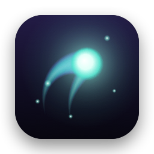
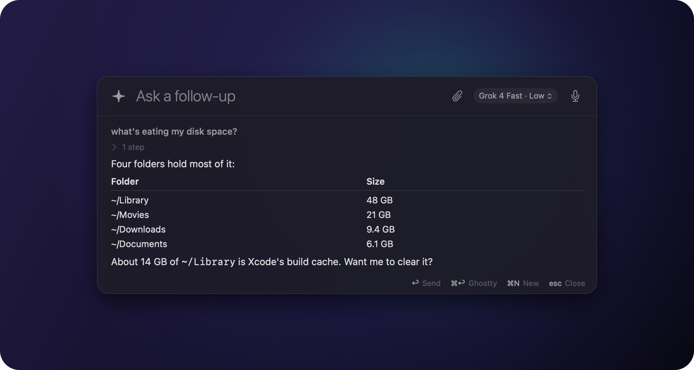
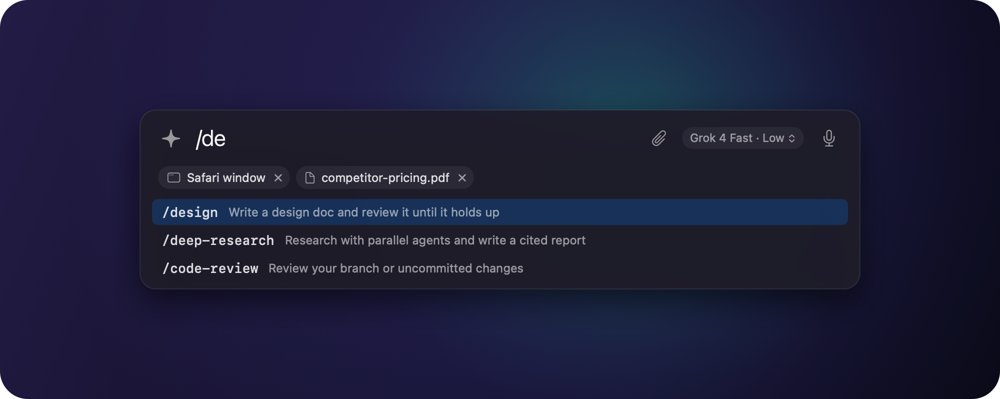
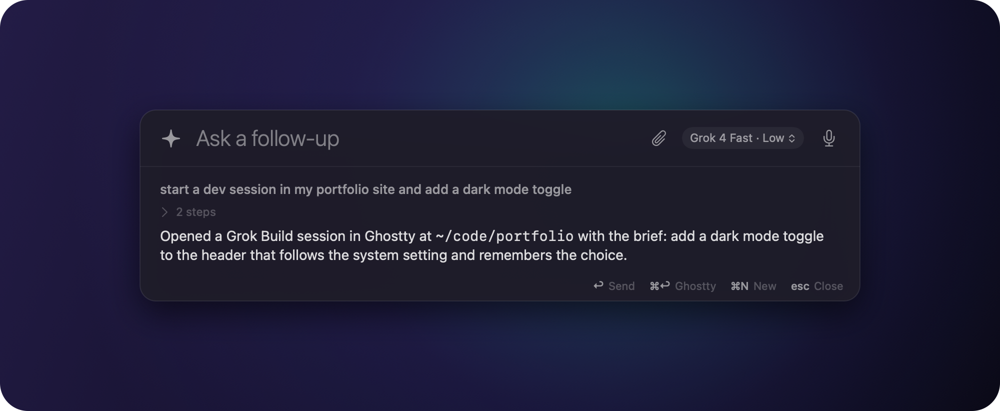

<p align="center">
  
</p>

<h1 align="center">Wisp</h1>

<p align="center">
  <strong>Ask anything. Hand off everything.</strong><br>
  A Spotlight-style AI launcher for your Mac.
</p>

<p align="center">
  <a href="https://github.com/yus100/wisp/actions/workflows/ci.yml"></a>
  
  
  <a href="LICENSE"></a>
</p>

<p align="center">
  
</p>

Tap **⌥ Space** from anywhere. Type or say what you need. Wisp answers with an AI agent that can see your Mac: your files, your apps, your terminal. When a quick question turns into real work, press **⌘ ↩** and the conversation becomes a full coding session.

## Why Wisp

- **Instant.** The agent stays warm in the background, so answers start streaming in a second or two.
- **Knows your machine.** It reads files, runs commands, and searches the web. No pasting context into a chat window.
- **Show it what you see.** ⌘ ⇧ A attaches the window you were just in. Paste or drop files and images too.
- **Talk to it.** Hold ⌥ Space and speak; let go to send. Or go hands-free with ⌥ ⇧ Space.
- **Your skills, one slash away.** Type `/` for Grok Build's commands, skills, and workflows.
- **Ask and walk away.** Close the panel mid-answer; a dot on the menu bar icon tells you it's ready.
- **Grows into real work.** One keystroke moves the conversation, context and all, into a coding session in [Ghostty](https://ghostty.org).
- **Any model.** Grok, Claude, GPT: whatever your Grok Build setup offers. Switch with ⌘ M.
- **Native and light.** A small Swift app that lives in the menu bar. No Electron, no browser tab, no new account.

## Bring your context

<p align="center">
  
</p>

Open Wisp over the app you're stuck in and press **⌘ ⇧ A**: the window goes along as a screenshot. Copied files, pasted images, and anything dropped on the panel come too. The agent opens them with its own tools, so it works with any model. Type `/` to run a skill or workflow on all of it.

## From a question to a coding session

<p align="center">
  
</p>

Ask for real work and Wisp finds the project, writes a brief, and opens a [Grok Build](https://x.ai/cli) session in Ghostty, ready to go. Already deep in a conversation? **⌘ ↩** carries it over with everything said so far. You land in your normal shell, in the right folder.

## Get started

You need macOS 14 or later, the Xcode Command Line Tools, the [Grok Build CLI](https://x.ai/cli) signed in with `grok login`, and [Ghostty](https://ghostty.org) 1.3+ for hand-off.

```sh
git clone https://github.com/yus100/wisp.git
cd wisp && make install
```

Then tap **⌥ Space**. macOS asks for the microphone, folder access, and Screen Recording (for attaching windows) the first time Wisp needs each.

## Shortcuts

| Keys | Action |
| --- | --- |
| **⌥ Space** | Show or hide Wisp |
| **⌥ Space**, hold | Talk; release to send |
| **⌥ ⇧ Space** | Hands-free voice |
| **↩** | Send (follow-ups keep the context) |
| **⌘ ⇧ A** | Attach the window you were in |
| **⌘ V** | Paste text, or attach copied files and images |
| **/** | Commands, skills, and workflows; **Tab** fills one in |
| **⌘ ↩** | Continue in Ghostty, or start a dev session for what you typed |
| **⌘ M** | Pick the model and reasoning effort |
| **⌘ N** | New conversation |
| **esc** | Close |

Everything else (hotkeys, default model, window or tab, working folder) lives in `~/.config/wisp/config.json` and applies as soon as you save. See the [guide](docs/guide.md).

## How it works

Wisp is a thin native shell around [Grok Build](https://x.ai/cli). It keeps one `grok agent` running and talks to it over the [Agent Client Protocol](https://agentclientprotocol.com), so every conversation is a regular Grok Build session, with your models, tools, and memory. That is why hand-off is seamless: Ghostty simply resumes the same session. Voice streams to the same speech-to-text service Grok Build uses, with the login you already have.

More in [architecture](docs/architecture.md).

## Privacy

Wisp itself collects nothing. Conversations go through Grok Build like any other session, and audio is streamed for transcription only while you dictate. Windows are captured only when you attach one, and Wisp deletes its screenshots and pasted images after a week. The agent acts with your permissions and doesn't ask before running commands, which is what makes it useful; the [guide](docs/guide.md#privacy-and-safety) covers what that means and how macOS permissions apply.

## Contributing

```sh
make test      # unit tests, about a second
make lint      # formatting
make help      # everything else
```

Start with [development](docs/development.md) and [architecture](docs/architecture.md).

## License

[MIT](LICENSE)
